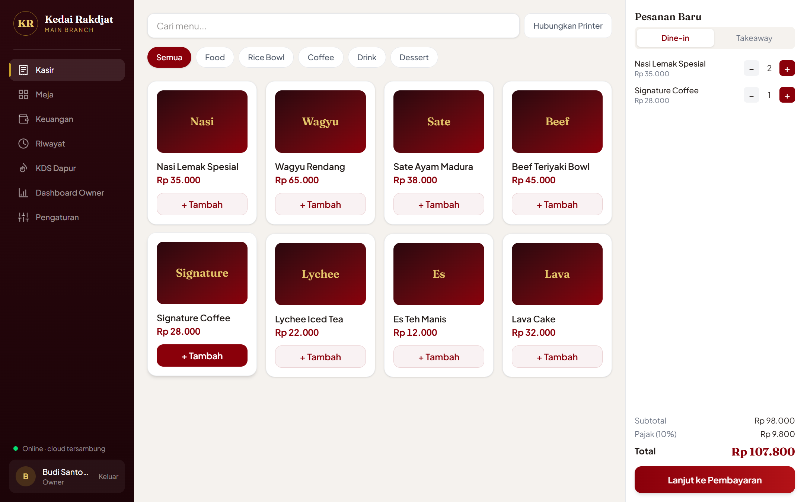
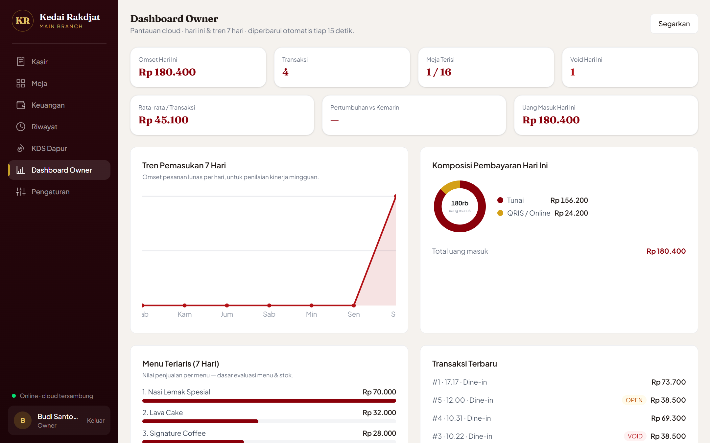

# Kedai Rakdjat POS

Panduan versi terbaru: [menu, pengeluaran, diskon, stok opname, backup dan migrasi schema 6](docs/operasional.md).

**Local-first point of sale for a real Indonesian kedai** — built for an Android tablet cashier, with cloud monitoring for the owner and a kitchen display system. Works fully offline; syncs to Supabase when a connection is available.





## Highlights

- **Offline-first cashier** — all transactions are written to IndexedDB (Dexie) first, so the register never stops when the internet does.
- **Dine-in table flow** — table map (available → occupied → cleaning), open orders per table, save-to-kitchen tickets, and temporary bills.
- **Shift management & cash reconciliation** — physical cash count per denomination, expected-vs-actual comparison, owner PIN authorization for discrepancies, QRIS/online income tracking.
- **Static QRIS payments** — shows the kedai's QRIS code; cashier confirms only after the merchant app/soundbox reports the payment.
- **Bluetooth thermal printing** — ESC/POS receipts, kitchen tickets, and temporary bills over Web Bluetooth.
- **Owner dashboard (cloud)** — today's revenue, payment mix, 7-day revenue trend, best-selling menu ranking, average ticket, and day-over-day growth — all rendered with dependency-free SVG charts.
- **Kitchen Display System (KDS)** — incoming → cooking → ready columns, live from the cloud.
- **PWA** — installable on the tablet home screen, standalone mode, precached app shell.
- **Split bill** — guests at one table pay for their own items; each part becomes its own paid order while the rest of the table stays open and the kitchen keeps one ticket.
- **Backup & recovery** — one-click JSON export/import, automatic daily and shift-close snapshots on the tablet, persistent-storage request, and **restore from cloud** onto a replacement tablet.

## Tech stack

| Layer | Technology |
| --- | --- |
| UI | React 19 + TypeScript, Tailwind CSS v4 |
| Local data | Dexie (IndexedDB), local-first source of truth |
| Cloud | Supabase (PostgreSQL + Row Level Security), supabase-js |
| Printing | Web Bluetooth, ESC/POS |
| Charts | Hand-rolled SVG (no chart library) |
| Build | Vite + vite-plugin-pwa |
| Typography | Plus Jakarta Sans + Fraunces (bundled locally, offline-safe) |

## Architecture

The tablet is the **source of truth**. Every record is keyed by `(device_id, local_id)` and pushed to Supabase as upserts after each transaction. The owner dashboard and KDS read from the cloud, so they stay up to date without touching the register.

```
Tablet (cashier)                    Supabase (cloud)
┌─────────────────────┐   push     ┌──────────────────────┐
│ React + Dexie       │ ─────────► │ orders, payments,    │
│ offline-first POS   │  upserts   │ products, tables, …  │
└─────────────────────┘            └──────────┬───────────┘
                                              │ read
                              ┌───────────────┴───────────────┐
                              ▼                               ▼
                     Owner dashboard                    KDS (kitchen)
                     revenue & charts                   incoming/cooking/ready
```

`kds_status` lives only in the cloud and is omitted from push payloads, so kitchen progress is never overwritten by the tablet.

## Getting started

### 1. Install

```bash
npm install
```

### 2. Set up Supabase

1. Create a project at [supabase.com](https://supabase.com).
2. Run [`0001_init.sql`](supabase/migrations/0001_init.sql), [`0002_secure_sync.sql`](supabase/migrations/0002_secure_sync.sql), [`0003_inventory_reporting.sql`](supabase/migrations/0003_inventory_reporting.sql), [`0004_operations.sql`](supabase/migrations/0004_operations.sql), [`0005_drawer_expenses.sql`](supabase/migrations/0005_drawer_expenses.sql), then [`0006_split_bill.sql`](supabase/migrations/0006_split_bill.sql) in the SQL Editor. Existing installations run only migrations not yet applied, in order. Follow [production setup](docs/production-setup.md) to provision accounts and device memberships before syncing. The app requires schema version 6 before acknowledging sync.
3. Create a `.env` file in the project root:

```env
VITE_SUPABASE_URL=https://YOUR_PROJECT.supabase.co
VITE_SUPABASE_ANON_KEY=YOUR_PUBLISHABLE_KEY
```

The publishable (anon) key is safe for client use. Alternatively, skip `.env` and fill in **Pengaturan → Koneksi Cloud** inside the app.

### 3. Run

```bash
npm run dev       # development
npm run build     # production build (PWA + service worker)
npm run preview   # serve the production build locally
```

### 4. Deploy (GitHub Pages)

Every push to `main` builds and publishes the app to **https://yance30.github.io/kedai-rakdjat/** via [`.github/workflows/pages.yml`](.github/workflows/pages.yml). One-time setup: **Settings → Pages → Source: GitHub Actions**. Optionally add repository variables `VITE_SUPABASE_URL` and `VITE_SUPABASE_ANON_KEY`; otherwise enter them in **Pengaturan → Koneksi Cloud**. HTTPS from Pages satisfies the PWA install and Web Bluetooth printing requirements.


Initial PINs: cashier `1111` · owner `1234`. The app requires replacement of these PINs on first login.

## Security notes

- Secrets are never committed: `.env` and data backups are gitignored.
- PINs migrate to salted PBKDF2 hashes on successful login and are excluded from cloud sync. Every 5 wrong PINs lock the device for longer (1 → 5 → 15 → 60 minutes); lockouts are listed under **Pengaturan → Riwayat Penguncian PIN**.
- Staff restored from a backup with an old-format PIN hash must set a new PIN at their next login.
- CI (GitHub Actions) runs unit, cloud-migration and browser tests plus the production build on every push to `main` and every pull request.
- Migration `0002_secure_sync.sql` removes permissive anonymous access. Authenticated device memberships restrict owner/cashier/kitchen roles. Public API keys are not secrets. Cloud writes use authorized atomic RPCs and generate a server-side audit trail.
- See [deployment, recovery, and verification instructions](docs/production-setup.md). Applying the code does not automatically migrate a live Supabase project.

## Project structure

```
src/
├── screens/          Login, Cashier, Meja, Report (Keuangan), History, Sales, Menu,
│                     Expenses, Inventory, OwnerDashboard, Cloud, Kds, Settings
├── components/       SVG charts, cloud login, cloud restore, diagnostics, setup guide
├── db.ts             Dexie schema and seeds
├── auth.ts           PBKDF2 PINs and escalating lockout
├── transactions.ts   sales, split bills, refunds/voids, shift close
├── inventory.ts      ingredients, recipes, stock movements, cost of goods
├── operations.ts     menu, expenses, waste and stocktake
├── backup.ts         backup validation/restore, automatic local snapshots
├── sync.ts           event-driven push sync to Supabase (sync-payload.ts builds the diff)
├── cloud-restore.ts  pull a device's data back from the cloud
├── supabase.ts       client bootstrap + device identity
├── printer.ts        ESC/POS builders + Web Bluetooth transport
└── money.ts          integer-rupiah helpers
supabase/
└── migrations/       cloud schema 0001–0006, applied in order
```

## Roadmap

- [ ] Hardware verification of Bluetooth printer on the kedai's device
- [ ] Production PWA rollout on the cashier tablet
- [x] Role-based RLS policies, cloud login, atomic incremental sync, validated recovery, transaction audit, and automated regression tests (production migration still required)
- [x] Date ranges, cashier filters and CSV exports in local and cloud reports
- [x] Persistent cart recovery and audited receipt copies
- [x] Ingredients, recipes, stock movements and transaction cost snapshots
- [x] Responsive tablet layout and browser/device diagnostics
- [x] Split bill per item, restore from cloud, automatic local snapshots (production migration 0006 required)

---

Built for **Kedai Rakdjat** · UI in Bahasa Indonesia
